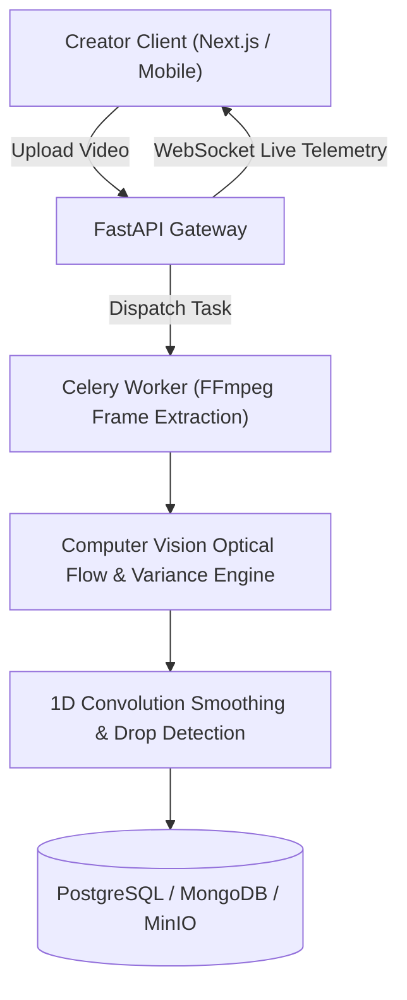

# VidPulse AI

AI video engagement analytics engine with frame-by-frame attention scoring, heatmaps, and hook optimization.

[Live Demo](TODO: add live link) | [Docs](docs/DESIGN.md) | [License](LICENSE)

---

## Features
- **Frame-by-Frame Engagement Scoring:** Combines proxy optical flow motion magnitude with luminance variance to compute real-time second-by-second attention scores.
- **Automated Attention Drop Isolation:** 1D convolution smoothing kernel automatically marks drop segments and categorizes drop severity (`critical`, `high`, `medium`, `low`).
- **Hook & Virality Metrics:** Identifies retention drop-off in the first 3 seconds to optimize video hooks and opening pacing.
- **WebSocket Live Progress:** Asynchronous Celery background processing with WebSocket status notifications.
- **Multi-Platform Ready:** Next.js 14 responsive web dashboard and React Native mobile companion app.

## Tech Stack
- **Frontend:** Next.js 14, TypeScript, Tailwind CSS, Recharts, Framer Motion
- **Backend:** FastAPI, Python 3.11, SQLAlchemy (PostgreSQL), Motor (MongoDB)
- **Background Workers:** Celery, Redis
- **Computer Vision:** OpenCV (Farneback Optical Flow), NumPy
- **Deploy:** Docker Compose, Railway, Render, GitHub Actions CI/CD

## Architecture



## Getting Started

### Prerequisites
- Python 3.11+
- Node.js 18+
- Docker & Docker Compose

### Quick Start with Docker
1. Clone the repository:
   ```bash
   git clone https://github.com/yashpatadiya1724-cmyk/vidpulse-ai.git
   cd vidpulse-ai
   ```

2. Copy environment template:
   ```bash
   cp .env.example .env
   ```

3. Launch full stack with Docker Compose:
   ```bash
   docker compose up --build
   ```
   Open `http://localhost:3000` to access the web console.

### Running Tests Locally
```bash
python backend/tests/test_analytics_engine.py
```

## API Endpoints

| Method | Endpoint | Description |
|---|---|---|
| `GET` | `/health` | API health check |
| `POST` | `/api/v1/auth/login` | JWT user authentication |
| `POST` | `/api/v1/videos/upload` | Upload video file for asynchronous engagement processing |
| `GET` | `/api/v1/analysis/{video_id}` | Retrieve frame-by-frame attention timeline and drop segments |
| `WS` | `/ws/{client_id}` | Real-time WebSocket connection for background job status |

## Security and Privacy
- **JWT Authentication:** Secure user identity with bcrypt-hashed credentials and token expiration.
- **Ephemeral Video Processing:** Uploaded videos are securely stored in private S3/MinIO buckets with short-lived presigned URLs.
- **Known Limitations:** Optical flow is proxy-sampled at 2 FPS to preserve compute; ultra-fast sub-second flashes may be smoothed by the moving average window.

## Roadmap
- [x] Fast heuristic optical flow engagement scoring
- [x] Attention drop segment convolution filter
- [x] Docker compose orchestration
- [ ] Direct YouTube & TikTok URL ingestion
- [ ] Speech-to-text transcript correlation with attention valleys

## What I Learned
- Full 4K dense optical flow is completely unsustainable for real-time video analytics without costly GPUs; downscaling proxy frames to 160x90 cuts compute by over 95% while retaining motion fidelity.
- Applying a 1D convolution smoothing filter eliminates noisy 1-second cuts from falsely registering as engagement drops.

## License
MIT
