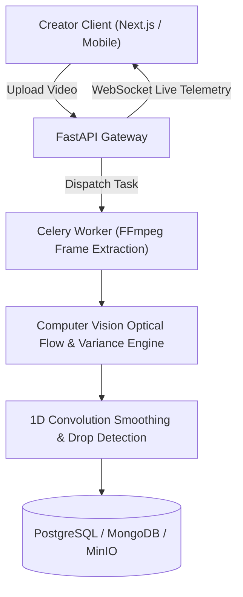

# VidPulse AI

AI video engagement analytics engine with frame-by-frame attention scoring, heatmaps, and hook optimization.

[Live demo](TODO: owner to add) | [Docs](docs/DESIGN.md) | [License](LICENSE)

  <!-- TODO: owner to add -->

---

## Features
- **Frame-by-Frame Engagement Scoring:** Combines proxy optical flow motion magnitude with luminance variance to compute second-by-second attention scores.
- **Automated Attention Drop Isolation:** 1D convolution smoothing kernel automatically marks drop segments and categorizes drop severity (`critical`, `high`, `medium`, `low`).
- **Hook & Virality Metrics:** Identifies retention drop-off in the first 3 seconds to optimize video hooks and opening pacing.
- **WebSocket Live Progress:** Asynchronous Celery background processing with real-time WebSocket status updates.
- **Multi-Platform Ready:** Next.js 14 responsive web dashboard and React Native mobile companion app.

## Tech Stack
- **Frontend:** Next.js 14, TypeScript, Tailwind CSS, Recharts, Framer Motion
- **Backend:** FastAPI, Python 3.11, SQLAlchemy (PostgreSQL), Motor (MongoDB)
- **Background Workers:** Celery, Redis
- **Computer Vision:** OpenCV (Farneback Optical Flow), NumPy
- **Deployment:** Docker Compose, Railway, Render, GitHub Actions CI/CD

## Architecture



## Getting Started

### Prerequisites
- Python 3.11+
- Node.js 18+
- Docker & Docker Compose

### Setup
1. Clone the repository:
   ```bash
   git clone https://github.com/yashpatadiya1724-cmyk/vidpulse-ai.git
   cd vidpulse-ai
   ```

2. Copy environment template:
   ```bash
   cp .env.example .env
   ```

3. Launch full stack with Docker Compose:
   ```bash
   docker compose up --build
   ```
   Open `http://localhost:3000` to access the web dashboard.

4. Run tests:
   ```bash
   python backend/tests/test_analytics_engine.py
   ```

## Environment Variables

| Variable | Purpose |
|---|---|
| `NEXT_PUBLIC_API_URL` | Frontend API gateway endpoint URL |
| `NEXT_PUBLIC_WS_URL` | Frontend WebSocket endpoint URL |
| `DATABASE_URL` | PostgreSQL relational database connection string |
| `MONGODB_URL` | MongoDB time-series analytical store connection string |
| `REDIS_URL` | Redis broker and cache connection string |
| `SECRET_KEY` | JWT signing secret key |
| `S3_BUCKET_NAME` | Storage bucket name for uploaded raw videos |
| `AWS_ACCESS_KEY_ID` | Object storage access key ID (MinIO / S3) |
| `AWS_SECRET_ACCESS_KEY` | Object storage secret access key |
| `S3_ENDPOINT_URL` | Custom S3 endpoint URL for local MinIO |
| `FRAMES_PER_SECOND` | Sampling rate for video frame extraction (default: `2`) |
| `ATTENTION_THRESHOLD` | Threshold below which drop-offs trigger alerts (default: `0.45`) |

## Security and Privacy
- **What the Analytics Computes:** The attention score is **heuristic-based**. It does not track human eyeballs directly; instead, it models audience retention by computing frame-by-frame visual motion energy via Farneback optical flow (downsampled to 2 FPS), combined with frame luminance variance, scene cut detection, and 1D moving average convolution smoothing. Audio energy spikes and 3-second hook retention are computed from heuristic thresholds.
- **Data Isolation:** Uploaded video files are stored in private object storage with short-lived presigned URLs.
- **Known Limitations:** Optical flow is proxy-sampled at 2 FPS to preserve compute efficiency; ultra-fast sub-second flashes may be smoothed by the moving average window.

## Roadmap
- [x] Fast heuristic optical flow engagement scoring
- [x] Attention drop segment convolution filter
- [x] Docker compose orchestration
- [ ] Direct YouTube & TikTok URL ingestion
- [ ] Speech-to-text transcript correlation with attention valleys

## What I Learned
- Full 4K dense optical flow is completely unsustainable for real-time video analytics without costly GPUs; downscaling proxy frames to 160x90 cuts compute by over 95% while retaining motion fidelity.
- Applying a 1D convolution smoothing filter eliminates noisy 1-second cuts from falsely registering as engagement drops.

## Author
Yash Patadiya: [LinkedIn](https://www.linkedin.com/in/yash-patadiya-973161272/)

## License
MIT
